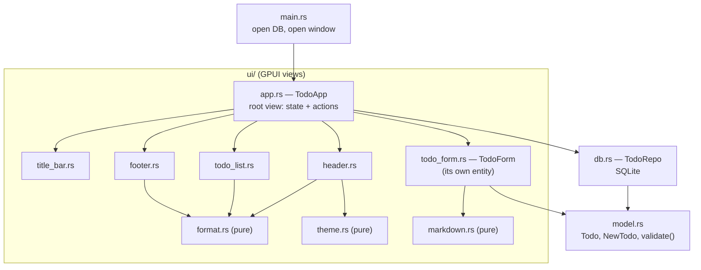
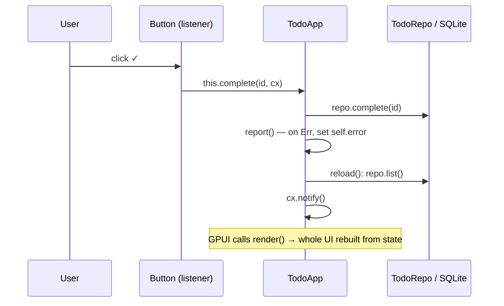

# Architecture Guide

This guide is for people new to the repo. It explains how the code is laid
out, how the pieces talk to each other, and how each feature actually works,
down to which GPUI calls make it happen. Read it next to the source; every
section names the file it describes.

- [1. The 60-second tour](#1-the-60-second-tour)
- [2. GPUI in five minutes](#2-gpui-in-five-minutes)
- [3. Code layout](#3-code-layout)
- [4. Startup: from `main` to the first frame](#4-startup-from-main-to-the-first-frame)
- [5. Data layer](#5-data-layer)
- [6. The root view: `TodoApp`](#6-the-root-view-todoapp)
- [7. Feature walkthroughs](#7-feature-walkthroughs)
- [8. Error handling](#8-error-handling)
- [9. Testing strategy](#9-testing-strategy)
- [10. Recipes: making common changes](#10-recipes-making-common-changes)
- [11. Gotchas](#11-gotchas)

---

## 1. The 60-second tour

The app is a single native window written in Rust on **GPUI** (the UI
framework behind the Zed editor), used through **`gpui-kit`**, which bundles
GPUI with the **`gpui-component`** widget library (buttons, inputs, date
picker, Markdown view, themes). Data lives in **SQLite** through `rusqlite`.

The code is split into three layers:



**The one idea to keep in mind:** `TodoApp` owns all the state. On every
change it writes to SQLite, reloads the list from SQLite, and calls
`cx.notify()`. GPUI then calls `render` again and the whole window is rebuilt
from that state. Nothing is updated in place, and the database is always the
source of truth.

---

## 2. GPUI in five minutes

If you have used React or SwiftUI, GPUI will feel familiar. These are the
concepts the code relies on:

| Concept | What it means here |
| --- | --- |
| **`App` / `Context<T>`** | `cx`, the handle to the runtime. `Context<T>` is the `cx` you get inside entity `T`'s methods; it can `notify()`, `emit()`, `listener()`, `subscribe()`. |
| **Entity (`Entity<T>`)** | A piece of state GPUI owns and you hold a handle to. Created with `cx.new(\|cx\| T::new(..))`. `TodoApp`, `TodoForm` and every input state are entities. |
| **View (`impl Render`)** | An entity that can draw itself. `render(&mut self, window, cx)` returns an element tree. It is called again after `cx.notify()`. |
| **Elements** | Built with a fluent, Tailwind-like API: `div().flex().gap_2().p_4().child(..)`. `h_flex()` and `v_flex()` (from gpui-component) are row and column shortcuts. |
| **`FluentBuilder`** | Adds `.when(cond, \|el\| ..)`, `.when_some(opt, \|el, v\| ..)` and `.map(..)`, for conditional children and styles. **You must import it:** `use gpui_kit::prelude::FluentBuilder;` |
| **`cx.listener(\|this, event, window, cx\| ..)`** | Turns a closure that needs `&mut self` into a click/change handler. This is how a button calls a `TodoApp` method. |
| **Events** | An entity declares `impl EventEmitter<E>`, calls `cx.emit(e)`, and a parent does `cx.subscribe(&entity, \|this, _, e, cx\| ..)`. Keep the returned `Subscription` alive, or the subscription ends. |
| **Theme** | `cx.theme()` (trait `ActiveTheme`) gives the current colours: `background`, `foreground`, `border`, `muted_foreground`, `danger`, `title_bar` and so on. Always use these instead of hard-coded colours, so light and dark mode both work. |
| **Element IDs** | Interactive or stateful elements need a stable id: `Button::new("new-todo")`, or `("done", id as u64)` for per-row ids. IDs must be unique among siblings. |

Everything is re-exported through `gpui_kit`:
`use gpui_kit::*;` for GPUI and `gpui_kit::component::...` for widgets.

---

## 3. Code layout

```
src/
  main.rs            Entry point: open the DB, start GPUI, open the window
  model.rs           Domain types (Todo, NewTodo) + validate()
  db.rs              TodoRepo: schema, CRUD, settings on SQLite
  ui/
    mod.rs           Module list
    app.rs           TodoApp root view: state, actions, top-level layout
    title_bar.rs     Custom title bar + the WindowOptions it needs
    header.rs        Greeting, open count, theme toggle, "+ New todo", switch
    todo_form.rs     TodoForm entity: title, Markdown description + toolbar, date
    todo_list.rs     Rows, per-row actions, inline delete confirmation
    footer.rs        Today's date
    format.rs        Pure helpers: greeting, counts, dates, filtering
    theme.rs         Pure helpers: theme setting parse/serialize, button label
    markdown.rs      Pure helpers: Markdown toolbar text edits
docs/
  ARCHITECTURE.md    This file
  superpowers/       Original design spec and implementation plan
```

**Conventions:**

- **Pure vs. GPUI code.** Anything that can be a plain function lives in a
  pure module (`model`, `format`, `theme`, `markdown`, and `db` against an
  in-memory DB) and is unit-tested. View files stay thin and contain layout
  and wiring only.
- **One root view with sections.** `header.rs`, `todo_list.rs`, `footer.rs`
  and `title_bar.rs` don't define their own types. Each adds a
  `render_*` method to `TodoApp` through `impl TodoApp { .. }` in its own
  file. They can read `TodoApp`'s state directly and attach
  `cx.listener(..)` handlers without passing callbacks around. Fields they
  need are `pub(super)`.
- **Real child entities only when needed.** `TodoForm` is its own entity
  because it owns input states (text fields, date picker) that must keep
  their state across renders.

---

## 4. Startup: from `main` to the first frame

`src/main.rs`:

1. **Open the database first, outside GPUI.**
   `TodoRepo::default_path()` resolves `dirs::data_dir()/gpui-hello/todos.db`
   (for example `~/.local/share/gpui-hello/todos.db`) and creates the folder.
   `TodoRepo::open` creates the tables if they are missing. If either step
   fails, the app prints an error and exits with code 1, because there is no
   useful app without storage.
2. **Start GPUI:** `application().with_assets(assets::Assets).run(..)`. The
   assets provide gpui-component's icons.
3. **`init(cx)`** initialises gpui-component: themes, key bindings for inputs
   and so on. It must run before any widget is used.
4. **Open the window** with `ui::title_bar::window_options(bounds)` (see
   [Title bar](#71-custom-title-bar)) at 640×720, centred.
   `gpui_kit::open_window` wraps our view in gpui-component's `Root`, which
   hosts popovers such as the date picker's calendar and tooltips.
5. **`TodoApp::new`** applies the saved theme, reads the "show completed"
   setting, and loads the todos. Then the first `render` happens.

---

## 5. Data layer

### 5.1 Model (`src/model.rs`)

- `Todo`: a stored row (`id`, `title`, `description`, `target_date:
  NaiveDate`, `completed`, `created_at`, `completed_at`).
- `NewTodo`: what the form produces (title, description, date), used for
  both add and update.
- `validate(title, description, date) -> Result<NewTodo, ValidationError>`
  trims the text, requires a non-blank title and a date, and returns
  `TitleRequired` or `DateRequired` with user-facing `message()` strings.

The form calls `validate`. The database never sees invalid data.

### 5.2 Repository (`src/db.rs`)

`TodoRepo` wraps a `rusqlite::Connection`. `rusqlite` is built with the
`bundled` feature, so SQLite is compiled in and users need nothing installed.

Schema (created with `CREATE TABLE IF NOT EXISTS`, so reopening an existing
file is safe):

```sql
todos(id INTEGER PRIMARY KEY AUTOINCREMENT, title, description,
      target_date TEXT  -- 'YYYY-MM-DD',
      completed INTEGER, created_at TEXT -- RFC 3339, completed_at TEXT NULL)
settings(key TEXT PRIMARY KEY, value TEXT)
```

| Method | Notes |
| --- | --- |
| `list()` | `ORDER BY id DESC`, so the newest is first. We sort by `id`, not `created_at`: local-time RFC 3339 strings can sort out of order around a daylight-saving change, while `AUTOINCREMENT` ids never do. A test pins this. |
| `add(&NewTodo) -> id` | Stamps `created_at` with microsecond precision. |
| `update(id, &NewTodo)` | Changes only title, description and date. `created_at` and list position stay put. |
| `complete(id)` | Sets `completed = 1` and stamps `completed_at`. |
| `delete(id)` | Hard delete. |
| `get_setting` / `set_setting` | Key/value store using an upsert (`ON CONFLICT DO UPDATE`). Keys in use: `show_completed` (`"1"`/`"0"`) and `theme` (`"light"`/`"dark"`). |

Rows are converted by `row_to_todo`. A bad date or timestamp string becomes
a `rusqlite` conversion error instead of a panic.

`open_in_memory()` is `#[cfg(test)]`. Tests use it, and it stays out of the
release binary.

---

## 6. The root view: `TodoApp`

`src/ui/app.rs`

```rust
pub struct TodoApp {
    repo: TodoRepo,                       // owns the DB connection
    todos: Vec<Todo>,                     // last result of repo.list()
    show_completed: bool,
    form: Option<Entity<TodoForm>>,       // Some = form panel visible
    editing: Option<i64>,                 // Some(id) = form edits that todo
    confirm_delete: Option<i64>,          // row currently asking "Delete?"
    error: Option<String>,                // red banner text
    _form_sub: Option<Subscription>,      // keeps the form subscription alive
}
```

**Every action follows the same pattern:**



- `report(what, result)` turns a `rusqlite::Error` into the banner message
  `"Could not <what>: <error>"` and returns `Option<T>`.
- `reload` re-reads the list and calls `cx.notify()`.

**Layout** (`render`):

```
v_flex (size_full, theme background/foreground)
├── render_title_bar()          ← fixed height, never scrolls
└── v_flex content (flex_1, min_h_0, padding)
    ├── render_header()
    ├── error banner            (when_some(self.error))
    ├── TodoForm entity         (when_some(self.form))
    ├── render_list()           ← flex_1 + overflow_y_scroll
    └── render_footer()
```

`min_h_0()` on the content and on the list is what lets the list shrink and
scroll instead of pushing the footer off-screen. That's the flexbox rule:
flex items default to `min-height: auto`.

---

## 7. Feature walkthroughs

### 7.1 Custom title bar

`src/ui/title_bar.rs`

**Goal:** the app's own bar with the title, drag-to-move, minimize and close,
and **no maximize**. gpui-component ships a `TitleBar`, but it always adds a
maximize button where the window manager supports one and zooms on
double-click. So we draw our own.

**Step 1: ask for a frameless window.** `window_options()` builds the
`WindowOptions`:

| Option | Why |
| --- | --- |
| `window_decorations: Some(WindowDecorations::Client)` | Asks the platform for client-side decorations (CSD): no system title bar, we draw it. |
| `titlebar: TitlebarOptions { appears_transparent: true, traffic_light_position, title }` | On macOS: hide the native bar but keep the traffic lights at (9, 9). The `title` still names the window for the OS (task switcher). |
| `app_owns_titlebar_drag: true` | We start window moves ourselves, so the OS must not treat the bar as its own drag region. |
| `window_min_size: 480×520` | Keeps the layout usable. |

**Step 2: render the bar** (`TodoApp::render_title_bar`). It is the first
child of the root `v_flex`, so it is always at the top:

- A 36px `h_flex` using the theme's `title_bar` and `title_bar_border`
  colours, so it follows light and dark mode.
- **Drag area:** the title text sits in an `h_flex` with `flex_1()` that
  fills the free space. It has:
  - `.window_control_area(WindowControlArea::Drag)`: tells platforms that
    hit-test (Windows) that this region drags the window.
  - `.on_mouse_down(Left, |_, window, _| window.start_window_move())`:
    starts an interactive move on Linux (Wayland/X11) and macOS.
  - No `on_double_click`, so double-clicking does **not** maximize.
- **Controls**, on the right:
  - **Minimize:** `Button` with `IconName::WindowMinimize` →
    `window.minimize_window()`. It is only shown when
    `window.window_controls().minimize` is true. Some tiling Wayland
    compositors can't minimize, and a dead button would be confusing.
  - **Close:** `IconName::WindowClose` → `cx.quit()`. We quit rather than
    `remove_window()`: this is a single-window app, and on Linux removing
    the last window doesn't necessarily end the process.

**Step 3: don't double up.** The controls are drawn only when
`window.window_decorations()` is `Decorations::Client` and we're not on
macOS:

- On **macOS** the system traffic lights are kept, so we only pad 80px on
  the left to leave room for them.
- If the platform falls back to **server-side decorations** (for example X11
  without a compositor, or a Wayland compositor that refuses CSD), the
  window manager already draws a title bar with its own buttons. Ours would
  be a duplicate, so we hide them and keep only the title strip.

### 7.2 Header: greeting, count, theme toggle, new todo, show completed

`src/ui/header.rs`

- **Greeting:** `format::greeting(Local::now().hour())` returns the morning
  (5–11), afternoon (12–16) or evening message. The hour is read at render
  time.
- **Open count:** `format::open_count_text(n)` handles pluralisation ("No
  open todos", "1 open todo", "3 open todos").
- **"+ New todo":** `this.open_form(None, ..)` (see [7.4](#74-add--edit-form)).
- **Show completed:** gpui-component `Switch`. `on_click` receives the
  *new* checked value and calls `set_show_completed`, which updates state
  and persists the `show_completed` setting.
- **Theme toggle:** see [7.8](#78-light--dark-mode).

### 7.3 The list

`src/ui/todo_list.rs`

- `format::visible(&todos, show_completed)` filters out completed todos when
  the switch is off. The order is already newest-first from the database.
- Empty result → `format::EMPTY_TEXT` ("Nothing to do — enjoy your day!").
- The container is `v_flex().id("todo-list").flex_1().min_h_0().overflow_y_scroll()`.
  The `id` is required: scrolling is stateful, so GPUI needs a stable
  identity to remember the scroll position.
- **Each row** (`render_row`):
  - Title in semibold. If completed: `.line_through()` on the title and
    `.opacity(0.5)` on the whole row, giving the faded, struck-through look.
  - Description rendered as Markdown (see [7.5](#75-markdown-description-and-toolbar)).
  - Due line `format::due_text(date)` ("due Nov 24"). Its colour is
    `theme.danger` when `format::is_overdue(todo, today)`, meaning still
    open and the date is before today, and `muted_foreground` otherwise.
  - The row uses `items_start()`, so action buttons stay at the top when a
    description spans several lines.
- **Per-row actions:** button ids are tuples like `("done", id as u64)` so
  every row's buttons are unique. Each handler captures `id` with `move`:
  - ✓ → `complete(id)`, ✎ → `open_form(Some(id))`. Both are only shown
    for open todos.
  - 🗑 → sets `confirm_delete = Some(id)` and notifies. That row then
    shows **"Delete? Yes / No"** instead of its normal buttons. Yes →
    `delete(id)` (which also closes the form if it was editing that todo),
    No → clears `confirm_delete`.

### 7.4 Add / edit form

`src/ui/todo_form.rs`

`TodoForm` is a separate entity. It holds three widget states:

| Field | Widget state | Rendered by |
| --- | --- | --- |
| `title` | `InputState` (single line) | `Input::new(&state)` |
| `description` | `TextareaState` (multi-line, `auto_grow(4, 12)`) | `Textarea::new(&state)` + toolbar |
| `date` | `DatePickerState` | `DatePicker::new(&state)` (calendar popover) |

- **Opening:** `TodoApp::open_form(id)` creates the form with
  `TodoForm::new(existing, ..)`. When editing, the values are pre-filled
  with `.default_value(..)` and `DatePickerState::set_date(..)`. It also
  subscribes to the form's events and stores the `Subscription` in
  `_form_sub`. Dropping it would silently stop the events.
- **Saving:** the Save button → `TodoForm::save` reads `value()` from each
  input and the picker's `date()` (`Date::Single(Option<NaiveDate>)`), then
  calls `model::validate`.
  - On error: shows `e.message()` in red inside the form.
  - On success: `cx.emit(TodoFormEvent::Submit(new_todo))`.
- **Parent reacts:** `TodoApp`'s subscription calls `submit`, which runs
  `repo.update(id, ..)` if `editing` is `Some(id)`, or `repo.add(..)`
  otherwise. Then it closes the form and reloads.
- **Cancel** emits `TodoFormEvent::Cancel` → `close_form`.

Why events instead of giving the form a `TodoRepo`? The form only knows how
to collect and validate input, and the parent decides what saving means. The
same form serves both add and edit, and there's a single owner of the
database.

### 7.5 Markdown description and toolbar

Two halves: **editing** with a toolbar, and **display** in the list.

**Editing** (`todo_form.rs` + `markdown.rs`):

The toolbar is a row of compact ghost `Button`s defined in a `BUTTONS`
table: **B**, *I*, `</>`, 🔗, **H**, •, **1.**, ❝. Each button calls
`TodoForm::format(MdFormat::X)`.

All the text logic lives in the pure function
`markdown::apply(text, selection, format) -> Edit`, where
`Edit { range, text, select }` means "replace `range` with `text`, then
select `select`". Offsets are UTF-8 byte offsets, the same units the input's
selection API uses. Two kinds of format:

- **Inline wraps** (bold `**`, italic `_`, code `` ` ``): wrap the
  selection and keep it selected inside the markers. With nothing selected,
  a placeholder ("bold text") is inserted and selected, so typing replaces
  it.
- **Link:** `[label](https://)` with the URL part selected, ready to paste.
  With nothing selected it inserts `[link text](https://)` and selects
  "link text".
- **Line prefixes** (heading `## `, bullet `- `, numbered `1. `/`2. `,
  quote `> `): the range expands to whole lines touched by the selection
  and each line gets the prefix. If **every** line already has it, the
  prefixes are removed instead, so pressing again toggles it off.

`TodoForm::format` applies the `Edit` as a single undoable change:

```rust
state.set_selected_range(edit.range, cx);   // select what to replace
state.replace(edit.text, window, cx);        // one atomic, undoable edit
state.set_selected_range(edit.select, cx);   // select the useful part
state.focus(window, cx);                     // put the caret back
```

We don't use `set_value` because it clears undo history.

**Display** (`todo_list.rs`): each row renders
`TextView::markdown(("desc", id), description)` from gpui-component's
`text` module, which parses and lays out Markdown (headings, lists, emphasis,
code, links, quotes) using theme colours. The element id is per row so each
view keeps its own state.

Descriptions are stored as plain Markdown text in the existing `description`
column. No schema change was needed.

### 7.6 Completing, deleting, ordering

- **Ordering:** newest first by `id` (see [5.2](#52-repository-srcdbrs)).
  Completing or editing never moves a row.
- **Complete:** `repo.complete` sets the flag and timestamp. The row then
  renders faded and struck through, and only offers delete.
- **Delete:** two-step inline confirmation in the row (see [7.3](#73-the-list)).
  There's no modal dialog, which keeps the code small.

### 7.7 Footer

`src/ui/footer.rs`: `format::footer_date(Local::now().date_naive())` with
chrono format `%A, %-d %B %Y` gives "Sunday, 22 November 2026", centred
above a top border.

### 7.8 Light / dark mode

`src/ui/theme.rs` (pure) + `app.rs` + `header.rs`

- **Stored as** setting `theme` = `"light"` | `"dark"`.
  `stored_dark(Option<&str>) -> Option<bool>` parses it. `None` means
  missing or unrecognised.
- **At startup** (`TodoApp::new`):
  - `Some(dark)` → `Theme::change(ThemeMode::Dark | Light, ..)`.
  - `None` → `Theme::sync_system_appearance(Some(window), cx)`, which
    follows the OS until the user picks a mode.
- **Toggling:** the header button's label comes from
  `toggle_label(is_dark)`. It names the mode you'd switch *to* ("🌙 Dark"
  or "☀️ Light"). Clicking it calls `toggle_theme`, which flips
  `cx.theme().is_dark()`, calls `Theme::change` (refreshes every window),
  and saves the setting.
- **Why it just works everywhere:** every colour in the UI comes from
  `cx.theme()`, including the title bar, borders, danger red and muted text.
  Never hard-code colours in a view.

### 7.9 Validation

`model::validate`, see [5.1](#51-model-srcmodelrs). The form shows the message
inline and stays open, so nothing is lost.

---

## 8. Error handling

| Where | Strategy |
| --- | --- |
| Opening the DB at startup | Print a message to stderr and `exit(1)`. The app can't do anything useful without it. |
| Any DB call after startup | `TodoApp::report` turns the error into a red banner under the header. The app keeps running and the previous list stays visible. A successful save clears the banner. |
| Bad data in a row | `row_to_todo` returns a conversion error. That surfaces through `list()` and lands in the banner. |
| Invalid form input | Never reaches the DB. `validate` errors are shown inside the form. |

There are no `unwrap()`s on user data or DB results in app code. The only
`expect` is on `open_window`, a startup failure GPUI can't recover from
anyway.

---

## 9. Testing strategy

Run `cargo test`. All tests are unit tests next to the code
(`#[cfg(test)] mod tests`):

| Module | What's covered |
| --- | --- |
| `model` | trimming, blank title, missing date, messages |
| `db` | newest-first order, ordering immune to clock offset changes, update keeps position and `created_at`, complete, delete, unicode/quotes round-trip, reopening a file keeps rows, settings upsert |
| `ui::format` | greeting hour boundaries, pluralisation, overdue rules, footer and due formats, show/hide filtering |
| `ui::theme` | setting parse/serialize round-trip, unknown values, toggle labels |
| `ui::markdown` | each wrap and prefix, placeholders, link selection, toggle-off, numbering, multibyte text |

The GPUI view code isn't unit-tested. Keep it thin by pushing logic into the
pure modules, where it's cheap to test, and check the UI by running the app.

---

## 10. Recipes: making common changes

**Add a field to a todo (say, a priority):**
1. `model.rs`: add it to `Todo` and `NewTodo`, and to `validate` if it
   needs rules.
2. `db.rs`: add the column. `CREATE TABLE IF NOT EXISTS` won't alter
   existing databases, so add an `ALTER TABLE .. ADD COLUMN` migration in
   `init` guarded by a schema version (`PRAGMA user_version`). Update the
   `SELECT`, `INSERT`, `UPDATE` and `row_to_todo`.
3. `todo_form.rs`: add a widget state, pre-fill it in `new`, and read it in
   `save`.
4. `todo_list.rs`: show it in `render_row`.
5. Tests in `model` and `db` first.

**Add a new setting:** pick a key, read it in `TodoApp::new` with a sensible
default, write it with `repo.set_setting` in the action that changes it, and
put any parsing in a pure helper with tests (see `theme.rs`).

**Add a toolbar button:** add a variant to `MdFormat`, handle it in
`markdown::apply` with tests, and add a row to `BUTTONS` in `todo_form.rs`.

**Add a new section of the screen:** create `ui/<section>.rs` with
`impl TodoApp { pub(super) fn render_<section>(&self, cx) -> impl IntoElement }`,
register it in `ui/mod.rs`, and add it as a child in `TodoApp::render`.

---

## 11. Gotchas

- **`.when()` / `.when_some()` not found?** Import
  `gpui_kit::prelude::FluentBuilder`.
- **Nothing changes on screen after a state change?** You forgot
  `cx.notify()`.
- **Form events stopped arriving?** The `Subscription` was dropped. Store
  it, like `_form_sub`.
- **List doesn't scroll / footer disappears?** A flex child in the chain is
  missing `min_h_0()`, or the scroll container is missing `.id(..)`.
- **Duplicate element id panics or odd state?** Per-row elements need
  per-row ids: `("name", id as u64)`.
- **Title bar shows two sets of buttons?** You're under server-side
  decorations. The `Decorations::Client` check in `render_title_bar` is
  what prevents this; keep it.
- **Linking on Linux:** `.cargo/config.toml` adds
  `/home/linuxbrew/.linuxbrew/lib` to the linker search path. Adjust or
  remove it for your machine.
- **Local data while developing:** the app always uses your real data
  folder. To test against a throwaway DB on Linux, run
  `XDG_DATA_HOME=$(mktemp -d) cargo run`.
